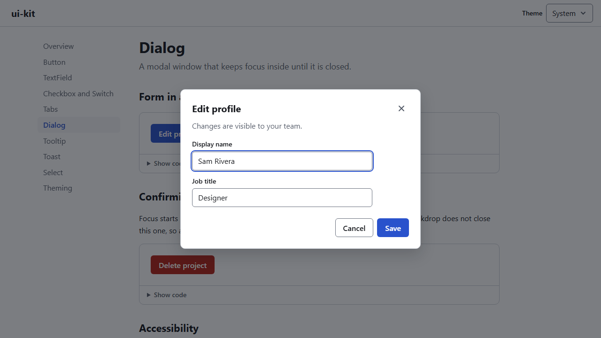
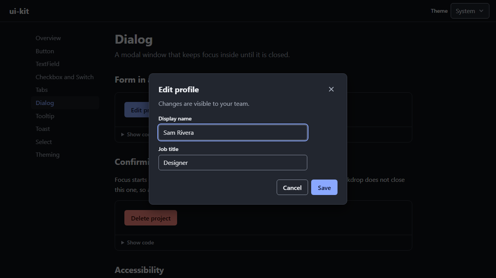

# ui-kit

Eight React components that you can use with only a keyboard, with a screen reader, or with a mouse, and
that look right in light and dark mode. Each one copies the behaviour described in the
[WAI-ARIA Authoring Practices Guide](https://www.w3.org/WAI/ARIA/apg/patterns/) (APG), and each one has tests
that press the keys and check the ARIA attributes.

**Docs and live examples:** https://ui-kit-brown-theta.vercel.app

[](https://github.com/Mdjamilh/ui-kit/actions/workflows/ci.yml)

| Light | Dark |
| --- | --- |
|  |  |

## The components

| Component | APG pattern | Keys it handles |
| --- | --- | --- |
| `Button` | [Button](https://www.w3.org/WAI/ARIA/apg/patterns/button/) | Enter, Space. Stays focusable while `loading`. |
| `TextField` | Native input | Native. Label, hint and error are wired through `aria-describedby` and `aria-invalid`. |
| `Checkbox` | [Checkbox](https://www.w3.org/WAI/ARIA/apg/patterns/checkbox/) | Space. Supports the mixed (indeterminate) state. |
| `Switch` | [Switch](https://www.w3.org/WAI/ARIA/apg/patterns/switch/) | Space, Enter |
| `Tabs` | [Tabs](https://www.w3.org/WAI/ARIA/apg/patterns/tabs/) | Arrows (by orientation), Home, End; Enter and Space in manual mode. Roving tabindex. |
| `Dialog` | [Modal dialog](https://www.w3.org/WAI/ARIA/apg/patterns/dialog-modal/) | Tab and Shift+Tab are trapped, Escape closes, focus goes back to the trigger. |
| `Tooltip` | [Tooltip](https://www.w3.org/WAI/ARIA/apg/patterns/tooltip/) | Shows on focus, Escape hides it. |
| `Select` | [Select-only combobox](https://www.w3.org/WAI/ARIA/apg/patterns/combobox/examples/combobox-select-only/) | Arrows, Home, End, Page Up/Down, Enter, Space, Tab, Alt+Up, Escape, typeahead. |
| `ToastProvider` and `useToast` | Live region | Tab reaches the dismiss buttons; timers pause on hover and focus. |

The docs site has a page per component with live examples, a props table and a keyboard table.

## How accessibility is handled

A few rules the components follow, and why:

- **Native elements first.** Button, TextField and Checkbox wrap the real HTML element, so forms, labels
  and the platform's keyboard behaviour work without extra code. ARIA is used only where HTML has no
  equivalent (tabs, switch, combobox, tooltip).
- **Labels are required props.** `TextField`, `Checkbox`, `Switch` and `Select` will not type-check without a
  `label`, and placeholders are never used as labels.
- **Focus is never lost.** A loading button uses `aria-disabled` instead of `disabled`, because disabling the
  focused button drops focus to the page. Dialogs return focus to whatever opened them. The docs site moves
  focus to the new heading when you navigate.
- **Live regions exist before their content.** Screen readers often skip a live region that is created at
  the same moment as its text, so the toast regions are rendered once, empty, and toasts are added inside.
  Errors use an assertive region and everything else is polite.
- **Hover content can be dismissed and hovered** (WCAG 1.4.13). The tooltip closes on Escape and stays open
  while the pointer moves onto it.
- **Motion and colour adapt.** Transitions drop to zero with `prefers-reduced-motion`. The switch shows its
  state by position, not only colour, and has a forced-colours rule.

## Using it

The package is not published to npm. Install it from GitHub; npm runs the `prepare` script, which builds
the library with tsup:

```sh
npm install github:Mdjamilh/ui-kit
```

React 19 is a peer dependency. Import the stylesheet once, then the components you need:

```tsx
import { useState } from "react";
import "@mdjamilh/ui-kit/styles.css";
import { Button, Dialog, ToastProvider, useToast } from "@mdjamilh/ui-kit";

function DeleteButton() {
  const [open, setOpen] = useState(false);
  const { toast } = useToast();
  return (
    <>
      <Button variant="danger" onClick={() => setOpen(true)}>Delete</Button>
      <Dialog
        open={open}
        onClose={() => setOpen(false)}
        title="Delete project?"
        description="You cannot undo this."
        footer={
          <Button variant="danger" onClick={() => { setOpen(false); toast({ title: "Deleted" }); }}>
            Delete
          </Button>
        }
      />
    </>
  );
}

// Wrap the app once so useToast works anywhere below.
<ToastProvider><App /></ToastProvider>;
```

The build ships ESM, CommonJS and type declarations. Components have no import-time side effects and the
package marks only CSS as a side effect, so bundlers drop what you do not import. CI checks this by bundling
an app that imports only `Button` and failing if code from any other component is in the output.

## Theming

Every colour, spacing step, radius and duration is a CSS variable prefixed with `--uk-`. The light theme is
the default; the dark theme applies when the system prefers dark, and `data-theme="light"` or
`data-theme="dark"` on `<html>` forces one. To brand it, override variables on any element:

```css
.brand {
  --uk-color-primary: #116b4a;
  --uk-color-primary-hover: #0b5137;
  --uk-color-on-primary: #ffffff;
}
```

The [Theming page](https://ui-kit-brown-theta.vercel.app/#/theming) lists every colour token with a swatch.

## Tests

| Layer | Tool | What it covers |
| --- | --- | --- |
| Unit and component (87 tests) | Vitest, Testing Library, user-event, axe-core | Every component: ARIA roles and attributes, every key in its keyboard table, controlled and uncontrolled use, and an axe scan of each state. |
| Browser (22 tests) | Playwright, @axe-core/playwright | Every docs page scanned with axe in the light and the dark theme, with no console errors allowed. The dialog focus trap, Escape, focus return and scroll lock in real Chromium. |
| Package | esbuild script | The built ESM output tree-shakes. |

axe in jsdom cannot measure colour contrast, so contrast is checked by the Playwright run, which renders
real pages in both themes. That run caught a real problem: the custom-theme example on the Theming page
was unreadable in dark mode until it also set `--uk-color-on-primary`.

Other bugs the tests found while building this: the loading button's name ran together as "SaveLoading";
the tooltip closed while the pointer crossed onto it; and the Select kept old typeahead text after closing,
so the next letter matched the wrong option.

## Working on it

```sh
npm ci                 # also builds the library through prepare
npm run dev:site       # docs site with hot reload, importing the library from src/
npm test               # unit and component tests
npm run test:e2e       # builds the docs and runs Playwright on port 47230
npm run lint
npm run typecheck
npm run build          # library to dist/
npm run build:site     # docs to site/dist/
```

`BASE_URL=https://ui-kit-brown-theta.vercel.app npm run test:e2e` runs the browser tests against the
deployed site instead of a local build.

Layout: `src/components/<name>/` holds each component, its CSS and its tests; `src/utils/` holds the shared
focus trap, scroll lock and controlled-state hooks; `site/` is the Vite docs app; `e2e/` is Playwright.

## Known gaps

- **No real screen reader testing yet.** Behaviour is checked with axe and keyboard tests, and the ARIA
  follows the APG, but it has not been tried with NVDA, JAWS or VoiceOver. Automated checks catch only
  part of what a person using a screen reader would notice.
- **The dialog does not make the rest of the page `inert`.** It relies on `aria-modal` and the focus trap.
  Most current screen readers respect `aria-modal`, but some older ones let the virtual cursor read the page
  behind it.
- **Tooltip placement is CSS only** (top or bottom). There is no collision detection, so a tooltip near the
  edge of the viewport can be clipped.
- **Select is single-choice only**, with no option groups, no search box and no virtualisation for very long
  lists. For most forms a native `<select>` is still the better choice.
- **Not tested with server rendering.** The toast region mounts after hydration, and the dialog portals to
  `document.body`.

## License

MIT. See [LICENSE](LICENSE).
